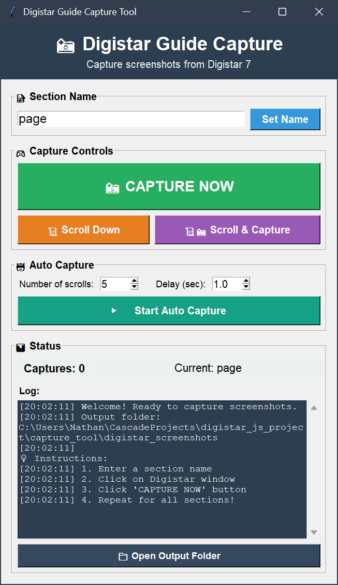

# Digistar Capture Tool

Screenshot capture utility for Digistar 7 user guide and application windows.

## Quick Start

### Installation
```powershell
pip install pyautogui pillow
```

### Launch GUI Tool
```powershell
python capture_gui.py
# Or use: start_capture_gui.bat
```

### Basic Usage
1. Enter section name
2. Focus Digistar window
3. Click "CAPTURE NOW"
4. Screenshots save to `digistar_screenshots/`



## Available Tools

- **`capture_gui.py`** - GUI-based capture (recommended)
- **`start_capture_gui.bat`** - Windows launcher
- **`capture_screenshots_simple.py`** - Hotkey-based alternative
- **`capture_digistar_guide.py`** - OCR-enabled version

## GUI Features

### Capture Controls
- **CAPTURE NOW**: Screenshot entire screen
- **Scroll Down**: Scroll 500 pixels down
- **Scroll & Capture**: Combined scroll and capture action

### Auto Capture
- Configure scroll count (1-50)
- Set delay between actions (0.5-5.0s)
- Automated capture for long documents

### Status Display
- Total captures count
- Current section name
- Activity log
- Quick folder access button

## Workflow

### Manual Capture
1. Launch capture GUI
2. Enter descriptive section name
3. Focus Digistar window
4. Click "CAPTURE NOW"
5. For long sections:
   - Click "Scroll Down" then "CAPTURE NOW"
   - Or use "Scroll & Capture" button
6. Repeat for each section
7. Click "Open Output Folder" to review

### Auto Capture (for long sections)
1. Open Digistar section
2. Enter section name
3. Set number of scrolls (e.g., 10)
4. Set delay between captures (e.g., 1.5 seconds)
5. Click "Start Auto Capture"
6. Tool automatically scrolls and captures

Process:
- Captures current view
- Scrolls down
- Waits specified delay
- Captures again
- Repeats for set count
- Stops automatically

## Hotkey Tool Alternative

For keyboard-based workflow:

```powershell
python capture_screenshots_simple.py
```

**Hotkeys:**
- **F9**: Capture screenshot
- **F10**: Scroll down
- **F11**: Set section name
- **ESC**: Exit tool

**Usage:**
1. Focus Digistar window
2. Press F11 to name section
3. Press F9 to capture
4. Press F10 to scroll if needed
5. Repeat for all sections
6. Press ESC when finished

## Output Format

Screenshots save to `digistar_screenshots/` with naming:
```
[number]_[section_name]_[timestamp].png
```

**Examples:**
```
001_introduction_20241206_130000.png
002_getting_started_20241206_130025.png
003_api_reference_20241206_130045.png
```

## OCR Version (Advanced)

For text extraction alongside screenshots:

### Requirements
1. Install Tesseract OCR from: https://github.com/UB-Mannheim/tesseract/wiki
2. Install to default location: `C:\Program Files\Tesseract-OCR`
3. Install Python packages:
   ```powershell
   pip install -r requirements_capture.txt
   ```

### Usage
```powershell
python capture_digistar_guide.py
```

**Output includes:**
- Screenshots in `digistar_guide_capture/screenshots/`
- Extracted text in `digistar_guide_capture/text/`
- Combined text file: `complete_guide.txt`

## Troubleshooting

### Installation Issues
```powershell
pip install --upgrade pyautogui pillow
```

### Common Problems

**Screenshots are blank:**
- Ensure Digistar window is focused before capture
- Verify window is not minimized
- Reposition window if needed

**Hotkeys not working:**
- Run PowerShell as Administrator
- Ensure script is running
- Click Digistar window to focus

**GUI won't start:**
- Verify Python packages installed
- Check Python version compatibility
- Run: `pip install --upgrade pyautogui pillow`

**Auto-capture too fast/slow:**
- Adjust delay value in settings
- 1.0-2.0 seconds works well for most cases

**Scroll amount wrong:**
- Edit `capture_gui.py` line with `pyautogui.scroll(-500)`
- Change value: larger = scroll more, smaller = scroll less

## Tips for Best Results

### Window Setup
- Maximize Digistar content area
- Position window consistently
- Minimize UI clutter if possible

### Section Naming
Use clear, descriptive names:
- ✓ `controls_overview`, `api_functions`, `troubleshooting`
- ✗ `section1`, `page`, `stuff`

### Scrolling Strategy
- Overlap captures slightly
- Check window bottom before moving on
- Better to capture too much than miss content

### Quality Control
- Review first few captures immediately
- Adjust scroll/delay if needed
- Verify all text is readable
- Recapture if necessary

## Alternative Methods

If Python tools don't work:

**Windows Snipping Tool:**
```
Press: Win + Shift + S
Manually capture regions
Save each screenshot
```

**Screen Recording:**
- Use OBS Studio or Windows Game Bar
- Record entire session
- Extract frames later

## After Capturing

1. **Review**: Open output folder and check all screenshots
2. **Organize**: Rename or create subfolders if needed
3. **Document**: Insert screenshots into Word/Google Docs
4. **Backup**: Copy folder to cloud storage or create ZIP archive
